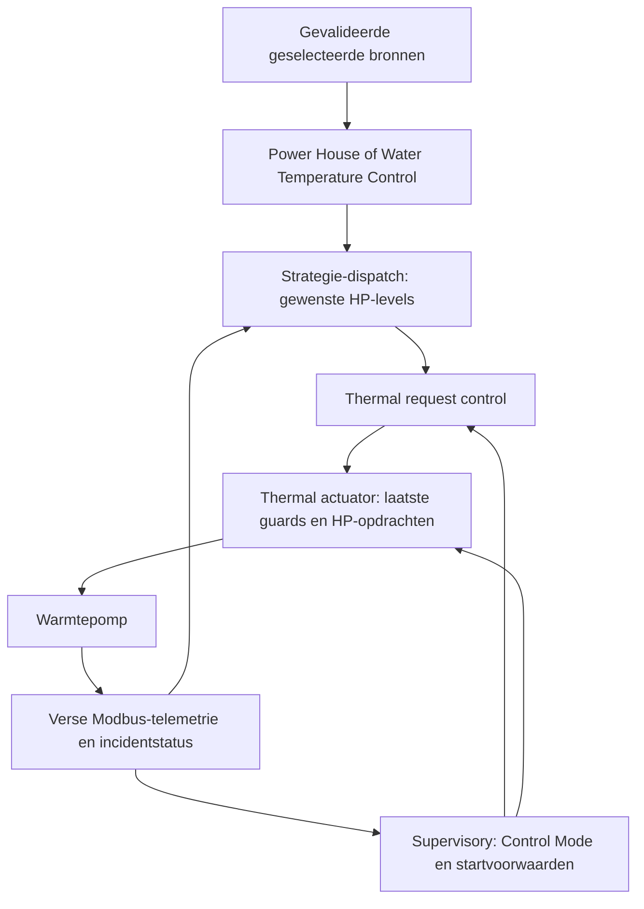

# Verwarmingsregeling: van warmtevraag tot compressor

Deze pagina beschrijft de actieve regeling van Power House en Water Temperature
Control voor Q Single en Duo. Voor bediening en afstelling zie
[Power House](../power-house.md) en [Water Temperature Control](../water-temperature-control.md).
Voor koelen zie [Koelregeling](koelregeling.md); voor code-uitbreiding zie
[Heating Strategy Development](heating-strategy-development.md).

## Vraag, toestemming en uitvoering

Een strategie berekent wat wenselijk is. Supervisory bepaalt de bedrijfsstand;
request control en de actuator bewaken vervolgens wat uitvoerbaar is. Een
positieve vraag betekent daarom niet dat een compressor onmiddellijk start.



De blokken draaien op eigen ticks; dit is een afhankelijkheidsdiagram, geen
synchrone functieaanroep. Timers, bronvaliditeit en teruggelezen toestand tellen
mee bij iedere beslissing.

| Begrip | Betekenis |
| --- | --- |
| `oq_strategy_requested_power_w` | Gewenst thermisch vermogen in W bij Power House; geen gemeten afgifte. |
| `oq_strategy_supply_target_temp` | Gewenste aanvoertemperatuur in °C bij stooklijnregeling. |
| `oq_demand_raw` | Genormaliseerde verwarmingsvraag `0..20`; geen Hz of fysiek ODU-standnummer. |
| `oq_ph_request_hp1_level`, `oq_curve_dispatch_hp1_level` | Strategie-uitvoer voor de per-HP levelkeuze; HP2 heeft overeenkomstige velden. |
| `oq_actuator_hp1_req` | Na request guards vrijgegeven actuatorinput; nog geen fysieke bevestiging. |
| `hp1_last_applied_level` | Bookkeeping van toegepaste opdrachten; verse frequentie-/modustelemetrie bewijst daadwerkelijk draaien of stoppen. |

De [frequentieruntime](../../openquatt/includes/control/oq_compressor_frequency_runtime.h)
en [ODU-levelmapping](../../openquatt/includes/odu/oq_odu_compressor_levels.h)
verbinden fysieke standen, bevestigde generatietabellen en frequentiegrenzen.
Een V2-standnummer en een stap op de demandschaal zijn niet uitwisselbaar.

## Power House: eerst watts, daarna een HP-combinatie

### Woninglijn en kamerfeedback

De handmatige woninglijn gebruikt `Tc` (`House cold temp`), `T0`
(`Maximum heating outdoor temperature`) en `Pr` (`Rated maximum house power`):

```text
H = Pr / (T0 - Tc)                         [W/K]
P_model = Pr × max(0, (T0 - Tout)/(T0 - Tc))
```

`Pr` bepaalt de demand- en slewschaal, geen bovengrens: onder `Tc` loopt de lijn
door. Behoud de volgorde van delen en vermenigvuldigen vanwege demandafronding.
De structurele `HouseLine` en de regelgrenzen in `PowerHouseEnvelope` hebben
aparte verantwoordelijkheden.

Een geldige externe warmtevraag kan het modeldeel vervangen. Kamerfeedback,
opbouw-/afbouwbegrenzing, waterlimieten en dispatch blijven daarna actief.
Bronselectie en korte cache-overbrugging worden door de runtime afgehandeld;
een externe waarde is geen rechtstreekse compressoropdracht.

De kamerfeedback gebruikt twee grenzen:

```text
warme grens = setpoint + comfort above
koude correctiegrens = min(setpoint + comfort memory - comfort below, warme grens)
onder koude correctiegrens: P_room = reactie × (koude correctiegrens - kamer)
tussen beide grenzen:      P_room = 0
boven warme grens:         P_room = reactie × (warme grens - kamer)
```

`comfort memory` bouwt bij aanhoudende achterstand langzaam op en neemt bij
herstel af. Daardoor kan dezelfde kamertemperatuur afhankelijk van de
voorgeschiedenis een andere vraag geven. Het gebruikerssetpoint verandert niet.
De directe warme correctie begint boven `setpoint + comfort above`.

Voorbeeld zonder comfort memory of verdere begrenzing: modelvraag 2.400 W,
setpoint 21 °C, ondermarge 0,2 K en reactie 3.000 W/K geven bij 20,7 °C een
correctie van 300 W en samen 2.700 W. Bij 21,0 °C is de directe correctie nul;
de modelvraag blijft bestaan. Het setpoint bereiken is geen zelfstandige stop.

### Begrenzen, starten en lage vraag

Na boot kent Power House een eenmalige input-wachtfase van maximaal 120 s.
Geldige inputs maken eerder rekenen mogelijk; de fase is geen verplichte
startvertraging of compressorvrijgave. Een strategy-reset begint deze bootgrace
niet opnieuw.

De som van feedforward en kamerfeedback wordt begrensd door de
installatie-envelope en de ingestelde opbouw-/afbouwtijd. De waterlimitfactor
reduceert de effectieve vraag. De dispatcher zoekt vervolgens een toegestane
HP-combinatie die deze vraag kan leveren.

Bij volle demand (20) blijven watts boven `Pr` behouden voor dispatch en
tekortberekening. Lagere stroomcaps blijven een wattgrens; nul blijft een stop.

Bij een bevestigde kamer- of setpointverhogingsvraag kan startondersteuning het
laagste geschikte vermogen vragen terwijl de gewone wattsvraag nog oploopt.
Kamerherstel kan die minimumondersteuning tot het setpoint voortzetten.
Flow-, water-, incident- en minimum-uit-tijdguards blijven gelden.

**Langer doorverwarmen** is een aparte, optionele toestandmachine. Een reeds
bevestigde verwarmingsrun kan bij lage vraag minimumvermogen blijven vragen
tot zijn comfortstopgrens. Inschakelen terwijl alles stilstaat start geen run.
Waterbegrenzing kan de minimumondersteuning intrekken; een latere herstartintentie
blijft afhankelijk van de gemeenschappelijke startvoorwaarden.

**Passief leren** observeert meetdata en past actieve model- of regelparameters
niet automatisch aan. De [learning-roadmap](power-house-autotuning-development.md)
is geen beschrijving van een reeds actieve adaptive regelaar.

### Single/Duo en het waterzijdige model

De dispatcher vergelijkt toegestane single- en duo-kandidaten. Elektrisch
ingangsvermogen, thermische dekking, beschikbare HP's, runtimebalans en
wisselhysterese bepalen samen de keuze. Een kleine berekende winst veroorzaakt
niet direct een topologiewissel.

Bij geldige flow en inlaattemperatuur voorspelt het model de waterketen
HP1 → HP2: de uitlaat van HP1 wordt de inlaat voor HP2. Bij ontbrekende
watermetingen bestaat een terugvalpad, waaronder de eigen verse uitlaattemperatuur
van een draaiende ODU. Defrost beïnvloedt de beschikbare capaciteit; extra
compensatie volgt alleen wanneer de combinatie anders tekortschiet. Een tekort
is input voor supervisory, geen directe ketel- of HP-write.

## Water Temperature Control: eerst een aanvoerdoel

1. Filter de geselecteerde buitentemperatuur en interpoleer tussen de zes
   stooklijnpunten. Bij ontbrekende buitenwaarde bestaat een ingestelde fallback.
2. Pas de stooklijnmodifier en de profielgebonden kamertrim toe en begrens het
   lokale doel. Een geldig extern aanvoertarget vervangt dit resultaat; daarop
   komt geen tweede kamertrim.
3. De ESPHome PID vergelijkt doel en geselecteerde systeemaanvoer. `Kp` reageert
   direct, `Ki` verwerkt langdurige afwijking en `Kd` de verandering. Ongeldige
   proceswaarde/doelwaarde leidt tot nulvraag en reset van de integrator.
4. De demandlogica bepaalt warmte-intentie, fase en herstartvrijgave. `HEAT`,
   `COAST` en `OFF` zijn geen Control Modes; `RECOVERY` en `MAINTAIN` beschrijven
   het fijnere regelgedrag. Rond het doel hoeft de vraag niet direct nul te worden.
   Een waterzijdige stop kan een profielgebonden herstartblokkade activeren;
   kamerwarmte heeft een eigen stop-/hervatvoorwaarde.
5. De dispatcher kiest frequentietoegestane levels met het actuele
   vermogensmodel. Bij Duo wordt eerst één HP benut; de tweede volgt pas als
   single-capaciteit en aanvoerafwijking dat onder de hysterese rechtvaardigen.
   Levelwijzigingen en topologiewissels worden begrensd.

Interpolatievoorbeeld: tussen 35 °C aanvoer bij 0 °C buiten en 32,5 °C bij
5 °C buiten ligt het basisdoel bij 2,5 °C op 33,75 °C. Een modifier van +1 K
maakt daar 34,75 °C van vóór kamertrim en limieten. De PID vertaalt het verschil
met de gemeten aanvoer naar vraag; het temperatuurdoel is geen compressorlevel.

## Gemeenschappelijke start-, stop- en ketenbeveiligingen

| Stand | Automatische rol |
| --- | --- |
| CM0 | Stand-by. |
| CM1 | Voor-/nacirculatie; een verstreken timer alleen geeft geen compressorvrijgave. |
| CM2 / CM3 | Verwarmen met HP's, bij CM3 met toegestane ketelondersteuning. |
| CM4 | Ketel-only foutfallback; automatische HP-requests nul. |
| CM5 | Koelen via de afzonderlijke koelstrategie. |
| CM98 / CM100 | Vorstcirculatie / service; eigen voorwaarden en service-eigenaars. |

Bij verwarmen overlapt de 30 s CM1-preflow flowopbouw, vraagbevestiging en
koude-watercontrole. Verse watermetingen en overige startvoorwaarden blijven
nodig nadat de timer verstreken is. Een queued Modbus-read bewijst geen verse
waterwaarde. Verlies van flow/vraag, OTA of service kan de probe annuleren;
een laat antwoord mag geen nieuwe circulatiesessie vrijgeven.

Per HP geldt standaard 240 s minimum-uit-tijd vanaf bevestigde stilstand.
Een normale stop kan worden uitgesteld door minimumlooptijd (productieondergrens
300 s); een harde veiligheidsstop heeft voorrang. De actuator begrenst ook
nieuwe startopdrachten tot zes per 60 minuten per compressor. Die RAM-historie
vervalt bij reboot; minimum-uit-tijd en het gecontroleerde herstartrecord
hebben een afzonderlijk contract, beschreven in [System Overview](system-overview.md#31-boot-and-first-run-timing).

De waterbewaking onderscheidt vermogenslimitfactor, ketelinhibit, trip en
hard trip. Standaard begint de zachte band 3 K onder `Maximum water temperature`;
de tripgrens ligt 5 K erboven. CM3 kent een eigen hard-tripbevestiging. Bij
`NaN` bewaart deze helper bestaande tripstate; ontbrekende proceswaarden moeten
daarnaast door hun consumenten worden afgehandeld. Een ontbrekende meting is
geen bewezen veilige temperatuur.

CM3-ketelassistentie en CM4-foutfallback hebben aparte ingangsvoorwaarden.
Een tekort, ontdooicyclus of positieve strategy-status is op zichzelf geen
ketelvrijgave. Zie [de keten van ketelopdracht tot uitgang](system-overview.md#81-transport-neutral-command-target-fulfilling-output).

## Diagnose: volg dezelfde beslisketen

| Waarneming | Controleer eerst |
| --- | --- |
| Geen warmtevraag | Bronvaliditeit, warmtetoestemming, actieve strategie en strategy-output. |
| Positieve vraag, nog geen start | CM1, flow, verse watercontrole, incidentstatus, minimum-uit-tijd en startlimiet. |
| Vraag hoger dan afgifte | Water-/stroomlimiet, toegestane frequenties, HP-beschikbaarheid en voorspelde capaciteit. |
| Setpoint bereikt, HP blijft draaien | Modelvraag, comfort memory, kamerherstel, langer doorverwarmen en minimumlooptijd. |
| Aanvoer boven doel, HP blijft kort draaien | Curvefase, stopbevestiging, minimale looptijd en harde guards afzonderlijk. |

Gebruik de [beslislog](control-replay-firmware.md) voor reden en overgang; een
actuele waarde verklaart niet altijd een eerder genomen stopbesluit.

## Bronnen en regressiegrenzen

- [Power House-vraag](../../openquatt/includes/control/oq_power_house_demand_logic.h),
  [runtime](../../openquatt/includes/control/oq_power_house_runtime.h) en
  [dispatch](../../openquatt/includes/control/oq_power_house_dispatch_logic.h).
- [Stooklijnlogica](../../openquatt/includes/control/oq_heating_curve_logic.h) en
  [runtime](../../openquatt/includes/control/oq_heating_curve_runtime.h).
- [Request runtime](../../openquatt/includes/control/oq_thermal_request_runtime.h),
  [actuator runtime](../../openquatt/includes/control/oq_thermal_actuator_runtime.h) en
  [watergrenzen](../../openquatt/includes/control/oq_thermal_limits_logic.h).
- [Warmte-intentie](../../tests/host/heat_intent_logic_test.cpp),
  [Power House-vraag](../../tests/host/oq_power_house_demand_logic_test.cpp),
  [run extension](../../tests/host/oq_power_house_run_extension_logic_test.cpp),
  [curveherstart](../../tests/host/heating_curve_restart_logic_test.cpp) en
  [frequentiedispatch](../../tests/host/heating_frequency_dispatch_test.cpp).

Code en YAML blijven de bron voor exacte grenzen en defaults. Hosttests bewijzen
beslislogica; fysieke timing, warmteafgifte en gecombineerde belasting vereisen
aparte HIL-validatie. Runresultaten horen bij de betreffende PR.
